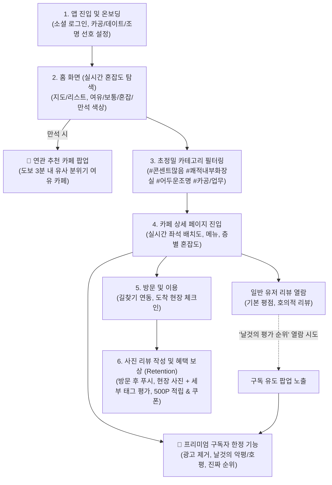

# 카페 101 (Cafe 101)
> **초정밀 맞춤형 카페 탐색 및 실시간 혼잡도 솔루션 앱**  
> 방문 전 실시간 혼잡도와 좌석 파악, 공간 세부 분위기(조명, 소음, 콘센트, 화장실) 필터링, 그리고 광고를 배제한 '날것의 평가 순위'를 제공합니다.

---

## 📌 1. 프로젝트 배경 및 문제 정의 (Problem Statement)

1. **실시간 혼잡도 파악 불가로 인한 대기 및 헛걸음**:
   - 방문 후 자리가 없거나 긴 대기 시간을 겪는 불편함 발생.
   - **솔루션**: 실시간 인구 분포 및 여유/보통/혼잡/만석 색상 상태 즉시 표시, 2D 인터랙티브 좌석 배치도, **만석 시 유사 분위기 대체 카페 자동 팝업 추천**.
2. **상세 분위기 및 메뉴 적합 카페 탐색의 어려움**:
   - 매장 내부 밝기(은은/어두운 조명 vs 밝은 통창 채광), 목적별 적합도(카공/업무, 데이트, 친목, 비즈니스 미팅 등) 및 편의시설(콘센트 구비율, 내부 화장실 청결도)을 사전 확인하기 어려움.
   - **솔루션**: 초정밀 맞춤 카테고리 필터링 (조명, 소음도 슬라이더, 콘센트 점유율 등).
3. **광고성 추천과 실제 이용자 평가 구분의 어려움**:
   - 블로그 체험단, 스폰서 광고 평점 왜곡으로 인한 신뢰 저하.
   - **솔루션**: 일반 유저를 위한 클린봇 필터 리뷰와 더불어 프리미엄 구독자 전용 **'날것의 호평/악평 및 광고 배제 진짜 순위(True Rank)'** 이원화 제공.
4. **소상공인(카페 사장님)의 매장 홍보 및 공실 좌석 해소**:
   - 비수기 시간대(14~17시) 좌석 공실 문제를 해결하기 위해 **원클릭 실시간 혼잡도 제어 및 타임딜 쿠폰 즉시 배포 대시보드** 제공.

---

## 🗺️ 2. 사용자 핵심 여정 (User Flow 1~6단계 완벽 구현)



### 상세 단계 설명:
1. **1단계: 앱 진입 및 온보딩**
   - 방문 목적(카공/업무, 데이트, 친목, 비즈니스 등), 선호 조명(어두운 조명, 밝은 통창), 필수 편의시설(콘센트, 내부 화장실)을 초기 선택하여 맞춤형 홈 화면 자동 구성.
2. **2단계: 홈 화면 (실시간 혼잡도 탐색)**
   - Leaflet 기반 인터랙티브 지도와 리스트 뷰.
   - 초록(여유, <45%), 노랑(보통, 45~75%), 주황(혼잡, 75~95%), 빨강(만석, >95%) 실시간 시각화.
   - **만석 클릭 시 연관 추천 카페 팝업**: 도보 3분 거리의 동일 조건(#콘센트많음 #어두운조명) 여유 카페 즉시 제안.
3. **3단계: 초정밀 카테고리 필터링 적용**
   - 원클릭 퀵 칩 태그 (#콘센트많음, #쾌적한내부화장실, #어두운조명, #카공/업무, #유행디저트).
   - 슬라이더 기반 상세 필터: 내부 조명 밝기 (1~5), 소음 허용 수준 (1~5), 최소 콘센트 비율 (0~100%), 내부 전용 남녀분리 화장실.
4. **4단계: 카페 상세 페이지 진입**
   - 2D 인터랙티브 실시간 좌석 배치도 (창가 1인석, 콘센트 유무, 점유 상태).
   - 시간대별 혼잡도 예측 차트 (14~16시 피크 예측).
   - **이원화 리뷰 시스템**:
     - *일반 리뷰*: 스폰서/협찬 포함 일반 평점 및 호의적인 리뷰.
     - *프리미엄 날것의 평가*: 클린봇 필터를 끈 진솔한 단점(에어컨 직타석, 주말 혼잡, 의자 착좌감) 및 진짜 순위.
5. **5단계: 방문 및 이용**
   - 도보 거리 및 예상 소요 시간 (도보 3분, 180m), 네비게이션 연동 시뮬레이션.
   - 현장 도착 체크인 버튼.
6. **6단계: 사진 리뷰 작성 및 혜택 보상 (Retention)**
   - 현장 사진 첨부 및 세부 항목 평가 태그.
   - 작성 완료 시 +500P 적립 및 무료 쿠폰 응모권 지급 (컨페티 축하 효과).
7. **[소상공인 사장님 모드 (B2B)]**:
   - 원클릭 혼잡도 및 잔여 좌석 수 제어.
   - 비수기 타임딜 할인 쿠폰 발행 및 주변 반경 500m 유저 대상 즉각 푸시 배포.

---

## 💻 3. 실행 방법 (Quick Start)

### 실행 옵션 1: Python 백엔드 서버 구동 (권장)
```bash
cd "C:\Users\user\.gemini\antigravity\scratch\cafe101"
python server.py
```
브라우저에서 `http://localhost:8000`에 접속합니다.

### 실행 옵션 2: 정적 파일 직접 실행
- `C:\Users\user\.gemini\antigravity\scratch\cafe101\index.html` 파일을 크롬 등 웹 브라우저로 더블 클릭하여 바로 실행할 수 있습니다. (외부 CDN 연동으로 자체 구동 가능)

---

## 🛠️ 4. 기술 스택 (Tech Stack)

- **Frontend**: HTML5, Modern CSS3, Tailwind CSS (Utility-first CDN), Lucide Icons, Leaflet.js (Map & Custom Pulsating Pin Markers), Canvas Confetti
- **Backend / API**: Python 3 (Native HTTP Server + RESTful JSON API Mocking)
- **UI/UX Pattern**: Responsive Glassmorphism, Dual-Mode Platform (Consumer & Cafe Owner), Freemium Review Architecture
